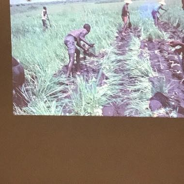

# Balanta Mangrove Rice Polder

*Also known as: Balanta bolanha rice*

**Encyclopedia ID 1235** (permanent) · https://bpupadhyaya.github.io/world-heritage-games-site/games/1235-balanta-mangrove-rice-polder/

*Photo: Demétrio Delizoicov Neto, [CC BY 4.0](https://creativecommons.org/licenses/by/4.0/), [source on Wikimedia Commons](https://commons.wikimedia.org/wiki/File:Brigada_balanta_de_agricultores.jpg)*

Build earth dikes and sluice gates around a tidal mangrove field so fresh rainwater is trapped and salt tide stays out, then plant and harvest rice.

## Heritage note

Part of the living heritage of Guinea-Bissau. Some forms of this practice carry deep meaning for the communities who keep it; here we describe the play and the craft only, with respect for its roots.

## Origins

Usually placed in the era of Crossroads and Golden Ages (about 500 to 1500), although its exact origins are uncertain, within the cultural world of Africa: Sahel, West and Central.

## Facts

- **Where:** Guinea-Bissau
- **Type:** Board and table games
- **Era:** [Crossroads and Golden Ages](../../eras/crossroads/index.md) (uncertain)
- **Cradle:** [Africa: Sahel, West and Central](../../cradles/africa-west/index.md)
- **Region:** Sub-Saharan Africa

## Related entries

- [Yote Capture Grid](../../games/167-yote-capture-grid/index.md)
- [Sahel Salt Caravan](../../games/172-sahel-salt-caravan/index.md)
- [Queah](../../games/885-queah/index.md)
- [Acadja Fish Park](../../games/1223-acadja-fish-park/index.md)
- [Vai Syllabary Decoder](../../games/1394-vai-syllabary-decoder/index.md)
- [Nzango](../../games/1422-nzango/index.md)

## Sources

- <https://commons.wikimedia.org/wiki/File:Brigada_balanta_de_agricultores.jpg>
