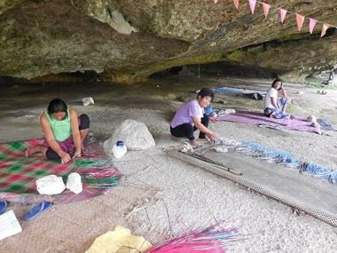

# Banig mat weaving

*banig · Banig*

**Encyclopedia ID 1236** (permanent) · https://bpupadhyaya.github.io/world-heritage-games-site/games/1236-banig-mat-weaving/

*Photo: Lawrence Ruiz, [CC BY-SA 4.0](https://creativecommons.org/licenses/by-sa/4.0/), [source on Wikimedia Commons](https://commons.wikimedia.org/wiki/File:Mat_(Banig)_Weaving_at_Saob_Cave_in_Brgy._Basiao,_Basey,_Samar.JPG)*

Interlace dyed palm strips over and under on a grid to reproduce a geometric banig pattern within a limited number of strips.

## Heritage note

Part of the living heritage of Philippines.

## Origins

A living tradition passed from person to person; it is not tied to a single dated origin. It belongs to the cultural world of Southeast Asia and the Islands.

## Facts

- **Where:** Philippines
- **Type:** Crafts and making
- **Family:** Textile and weaving crafts
- **Era:** [Living Traditions](../../eras/living/index.md)
- **Cradle:** [Southeast Asia and the Islands](../../cradles/southeast-asia/index.md)
- **Region:** East and Southeast Asia

## Related entries

- [Ketupat](../../games/322-ketupat/index.md)
- [Batik wax-resist pattern studio](../../games/105-batik-wax-resist-pattern-studio/index.md)
- [Lao silk brocade weaving](../../games/311-lao-silk-brocade-weaving/index.md)
- [Songket](../../games/320-songket/index.md)
- [Tais](../../games/321-tais/index.md)
- [Kente strip weaving](../../games/22-kente-strip-weaving/index.md)

## Sources

- <https://commons.wikimedia.org/wiki/File:Mat_(Banig)_Weaving_at_Saob_Cave_in_Brgy._Basiao,_Basey,_Samar.JPG>
- <https://en.wikipedia.org/wiki/Banig>
