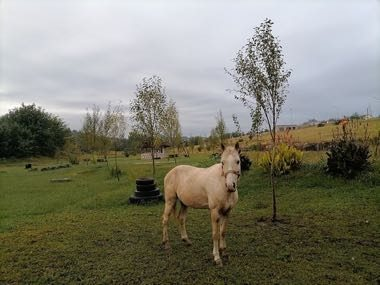

# Basotho pony mountain race

*Basotho pony mountain race*

**Encyclopedia ID 1238** (permanent) · https://equalinformation.com/world-heritage-games-site/games/1238-basotho-pony-mountain-race/

*Photo: Nakengtsapoho, [CC0](https://creativecommons.org/publicdomain/zero/1.0/), [source on Wikimedia Commons](https://commons.wikimedia.org/wiki/File:Pere_ya_Basotho.jpg)*

Ride a sure-footed Basotho pony along a mountain track, pacing stamina and choosing lines to beat rivals to the finish.

## Heritage note

Part of the living heritage of Lesotho. Animals are partners in this tradition; good care and local rules always come first.

## Origins

Usually placed in the era of Age of Contact and Craft (about 1500 to 1800), although its exact origins are uncertain, within the cultural world of Africa: Southern Africa.

## Facts

- **Where:** Lesotho
- **Type:** Racing
- **Era:** [Age of Contact and Craft](../../eras/contact/index.md) (uncertain)
- **Cradle:** [Africa: Southern Africa](../../cradles/africa-south/index.md)
- **Region:** Sub-Saharan Africa

## Related entries

- [Mokoro polling](../../games/1338-mokoro-polling/index.md)
- [Capoeira Angola](../../games/543-capoeira-angola/index.md)
- [Basotho blanket pattern designer](../../games/201-basotho-blanket-pattern-designer/index.md)
- [Umlabalaba](../../games/881-umlabalaba/index.md)
- [Mashonisa](../../games/882-mashonisa/index.md)
- [Diketo](../../games/1076-diketo/index.md)

## Sources

- <https://commons.wikimedia.org/wiki/File:Pere_ya_Basotho.jpg>
