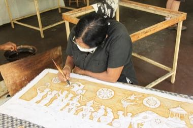

# Sri Lankan batik wax-resist painting

*බතික්*

**Encyclopedia ID 1239** (permanent) · https://equalinformation.com/world-heritage-games-site/games/1239-sri-lankan-batik-wax-resist-painting/

*Photo: Peter van der Sluijs, [CC BY-SA 3.0](https://creativecommons.org/licenses/by-sa/3.0/), [source on Wikimedia Commons](https://commons.wikimedia.org/wiki/File:Woman_with_brush_painting_batik_Sri_Lanka.JPG)*

Draw wax outlines on cloth, then dye in coloured baths in the right order so each layer of resist keeps its colour, ending with a finished wall hanging.

## Heritage note

Part of the living heritage of Sri Lanka.

## Origins

A living tradition passed from person to person; it is not tied to a single dated origin. It belongs to the cultural world of South Asia.

## Facts

- **Where:** Sri Lanka
- **Type:** Crafts and making
- **Family:** Textile and weaving crafts
- **Era:** [Living Traditions](../../eras/living/index.md)
- **Cradle:** [South Asia](../../cradles/south-asia/index.md)
- **Region:** South and Central Asia

## Related entries

- [Dhaka weave pattern loom](../../games/115-dhaka-weave-pattern-loom/index.md)
- [Phulkari darn-stitch embroidery](../../games/257-phulkari-darn-stitch-embroidery/index.md)
- [Bandhani tie-dye](../../games/258-bandhani-tie-dye/index.md)
- [Kantha running-stitch quilt](../../games/284-kantha-running-stitch-quilt/index.md)
- [Nakshi Kantha embroidery](../../games/294-nakshi-kantha-embroidery/index.md)
- [Allo nettle fibre weaving](../../games/1228-allo-nettle-fibre-weaving/index.md)

## Sources

- <https://commons.wikimedia.org/wiki/File:Woman_with_brush_painting_batik_Sri_Lanka.JPG>
