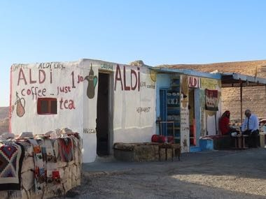

# Bedouin Coffee Pour

*Qahwa Bedawiyya / قهوة بدوية*

**Encyclopedia ID 1240** (permanent) · https://equalinformation.com/world-heritage-games-site/games/1240-bedouin-coffee-pour/

*Photo: Fallaner, [CC BY-SA 4.0](https://creativecommons.org/licenses/by-sa/4.0/), [source on Wikimedia Commons](https://commons.wikimedia.org/wiki/File:Jordan_2021_P135_Aldi_Bedouin_Coffee.jpg)*

Roast, grind, boil in the dallah and pour tiny cups from a height without spilling, serving guests in the right order with the proper amount.

## Heritage note

Part of the living heritage of Jordan. Some forms of this practice carry deep meaning for the communities who keep it; here we describe the play and the craft only, with respect for its roots.

## Origins

A living tradition passed from person to person; it is not tied to a single dated origin. It belongs to the cultural world of Mesopotamia, Levant and Arabia.

## Facts

- **Where:** Jordan
- **Type:** Crafts and making
- **Family:** Winter sports
- **Era:** [Living Traditions](../../eras/living/index.md)
- **Cradle:** [Mesopotamia, Levant and Arabia](../../cradles/mesopotamia-levant/index.md)
- **Region:** Middle East and North Africa

## Related entries

- [Wire car](../../games/85-wire-car/index.md)
- [Bamboo scaffold builder](../../games/369-bamboo-scaffold-builder/index.md)
- [Neon sign bender](../../games/371-neon-sign-bender/index.md)
- [Maple taffy on snow](../../games/441-maple-taffy-on-snow/index.md)
- [Dumpling Pleating](../../games/499-dumpling-pleating/index.md)
- [Freetown Beach Seine Haul](../../games/1282-freetown-beach-seine-haul/index.md)

## Sources

- <https://commons.wikimedia.org/wiki/File:Jordan_2021_P135_Aldi_Bedouin_Coffee.jpg>
