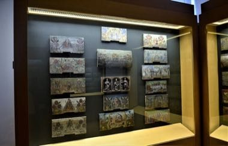

# Beehive Panel Painter

*Also known as: Panjske končnice*

**Encyclopedia ID 1241** (permanent) · https://bpupadhyaya.github.io/world-heritage-games-site/games/1241-beehive-panel-painter/

*Photo: CeeGee, [CC BY-SA 4.0](https://creativecommons.org/licenses/by-sa/4.0/), [source on Wikimedia Commons](https://commons.wikimedia.org/wiki/File:BeekeepingMuseumRadovljica_(13).jpg)*

Match small painted scenes to the right panel front on a stacked apiary, uncover funny proverb pictures and complete a wall of hive fronts.

## Heritage note

Part of the living heritage of Slovenia.

## Origins

A living tradition passed from person to person; it is not tied to a single dated origin. It belongs to the cultural world of Mediterranean.

## Facts

- **Where:** Slovenia
- **Type:** Crafts and making
- **Family:** Paper, ink and painting crafts
- **Era:** [Living Traditions](../../eras/living/index.md)
- **Cradle:** [Mediterranean](../../cradles/mediterranean/index.md)
- **Region:** Europe

## Related entries

- [Sicilian Cart Painting](../../games/399-sicilian-cart-painting/index.md)
- [Gallarija Balcony Builder](../../games/1286-gallarija-balcony-builder/index.md)
- [Licitar Heart Decorator](../../games/1326-licitar-heart-decorator/index.md)
- [Luzzu Boat Painter](../../games/1330-luzzu-boat-painter/index.md)
- [Ebru paper marbling](../../games/20-ebru-paper-marbling/index.md)
- [Ndebele geometric wall painting](../../games/23-ndebele-geometric-wall-painting/index.md)

## Sources

- <https://commons.wikimedia.org/wiki/File:BeekeepingMuseumRadovljica_(13).jpg>
