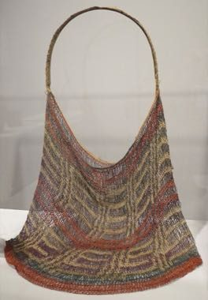

# Bilum looped string bag

*Bilum*

**Encyclopedia ID 1242** (permanent) · https://bpupadhyaya.github.io/world-heritage-games-site/games/1242-bilum-looped-string-bag/

*Photo: Hiart, [CC0](https://creativecommons.org/publicdomain/zero/1.0/), [source on Wikimedia Commons](https://commons.wikimedia.org/wiki/File:String_bag_(bilum)_from_Papua_New_Guinea,_Honolulu_Museum_of_Art.JPG)*

Loop coloured thread row by row to build a bag, choosing colour order to form the designs, then fill it with market goods.

## Heritage note

Part of the living heritage of Papua New Guinea.

## Origins

A living tradition passed from person to person; it is not tied to a single dated origin. It belongs to the cultural world of Pacific and Oceania.

## Facts

- **Where:** Papua New Guinea
- **Type:** Crafts and making
- **Family:** String instruments
- **Era:** [Living Traditions](../../eras/living/index.md)
- **Cradle:** [Pacific and Oceania](../../cradles/pacific/index.md)
- **Region:** Oceania and Pacific

## Related entries

- [Santur Hammer Strings](../../games/138-santur-hammer-strings/index.md)
- [Dan bau](../../games/143-dan-bau/index.md)
- [Santoor](../../games/151-santoor/index.md)
- [Goje One-String Fiddle](../../games/176-goje-one-string-fiddle/index.md)
- [Masenqo and the azmari](../../games/187-masenqo-and-the-azmari/index.md)
- [Hira gasy village troupe contest](../../games/205-hira-gasy-village-troupe-contest/index.md)

## Sources

- <https://commons.wikimedia.org/wiki/File:String_bag_(bilum)_from_Papua_New_Guinea,_Honolulu_Museum_of_Art.JPG>
