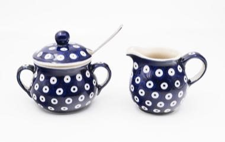

# Bolesławiec Stamped Pottery

*Ceramika bolesławiecka*

**Encyclopedia ID 1244** (permanent) · https://equalinformation.com/world-heritage-games-site/games/1244-bolesawiec-stamped-pottery/

*Photo: Jacek Halicki, [CC BY-SA 4.0](https://creativecommons.org/licenses/by-sa/4.0/), [source on Wikimedia Commons](https://commons.wikimedia.org/wiki/File:2023_Ceramika_boles%C5%82awiecka_(1).jpg)*

Press sponge stamps in a repeating dotted-and-floral pattern around a cobalt-glazed jug or bowl, then fire it and see how your design looks.

## Heritage note

Part of the living heritage of Poland.

## Origins

A living tradition passed from person to person; it is not tied to a single dated origin. It belongs to the cultural world of Northern and Eastern Europe.

## Facts

- **Where:** Poland
- **Type:** Crafts and making
- **Family:** Pottery, wood and metal crafts
- **Era:** [Living Traditions](../../eras/living/index.md)
- **Cradle:** [Northern and Eastern Europe](../../cradles/north-east-europe/index.md)
- **Region:** Europe

## Related entries

- [Horezu ceramics](../../games/384-horezu-ceramics/index.md)
- [Skrabalai](../../games/388-skrabalai/index.md)
- [Bulgarian Painted Pottery](../../games/1388-bulgarian-painted-pottery/index.md)
- [Zellij tile mosaic](../../games/21-zellij-tile-mosaic/index.md)
- [Swahili carved door](../../games/90-swahili-carved-door/index.md)
- [Thai fruit and vegetable carving](../../games/114-thai-fruit-and-vegetable-carving/index.md)

## Sources

- <https://commons.wikimedia.org/wiki/File:2023_Ceramika_boles%C5%82awiecka_(1).jpg>
