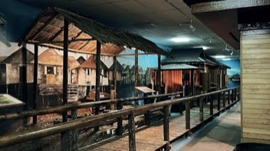

# Stilt-village builder

*Kampong Ayer*

**Encyclopedia ID 1248** (permanent) · https://equalinformation.com/world-heritage-games-site/games/1248-stilt-village-builder/

*Photo: Tawinann, [CC BY-SA 4.0](https://creativecommons.org/licenses/by-sa/4.0/), [source on Wikimedia Commons](https://commons.wikimedia.org/wiki/File:Traditional_Malay_Craftsmanship_%26_Technology_in_Brunei_07.jpg)*

Lay out a village of stilt-houses, walkways, bridges and a market jetty on the water so every house connects to a landing and keeps its boat berth free.

## Heritage note

Part of the living heritage of Brunei, Malaysia. Some forms of this practice carry deep meaning for the communities who keep it; here we describe the play and the craft only, with respect for its roots.

## Origins

A living tradition passed from person to person; it is not tied to a single dated origin. It belongs to the cultural world of Southeast Asia and the Islands.

## Facts

- **Where:** Brunei, Malaysia
- **Type:** Crafts and making
- **Era:** [Living Traditions](../../eras/living/index.md)
- **Cradle:** [Southeast Asia and the Islands](../../cradles/southeast-asia/index.md)
- **Region:** East and Southeast Asia

## Related entries

- [Batik wax-resist pattern studio](../../games/105-batik-wax-resist-pattern-studio/index.md)
- [Songket](../../games/320-songket/index.md)
- [Ketupat](../../games/322-ketupat/index.md)
- [Shophouse facade builder](../../games/1373-shophouse-facade-builder/index.md)
- [Greasy pole climb](../../games/77-greasy-pole-climb/index.md)
- [Thai fruit and vegetable carving](../../games/114-thai-fruit-and-vegetable-carving/index.md)

## Sources

- <https://commons.wikimedia.org/wiki/File:Traditional_Malay_Craftsmanship_%26_Technology_in_Brunei_07.jpg>
