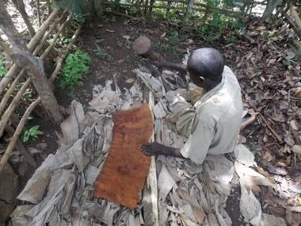

# Buganda barkcloth making

*Also known as: Olubugo*

**Encyclopedia ID 1249** (permanent) · https://bpupadhyaya.github.io/world-heritage-games-site/games/1249-buganda-barkcloth-making/

*Photo: Joyce Nanjobe Kawooya joycenanjobekawooya@gmail.com, [CC BY-SA 4.0](https://creativecommons.org/licenses/by-sa/4.0/), [source on Wikimedia Commons](https://commons.wikimedia.org/wiki/File:Back_cloth_preparation_from_a_fig_tree_in_Uganda_04.jpg)*

Strip the mutuba bark, beat it with mallets to broaden the cloth, and dry it.

## Heritage note

Part of the living heritage of Uganda. Some forms of this practice carry deep meaning for the communities who keep it; here we describe the play and the craft only, with respect for its roots.

## Origins

A living tradition passed from person to person; it is not tied to a single dated origin. It belongs to the cultural world of Africa: Great Lakes and Indian Ocean.

## Facts

- **Where:** Uganda
- **Type:** Crafts and making
- **Era:** [Living Traditions](../../eras/living/index.md)
- **Cradle:** [Africa: Great Lakes and Indian Ocean](../../cradles/africa-east/index.md)
- **Region:** Sub-Saharan Africa

## Related entries

- [Amadinda and embaire](../../games/185-amadinda-and-embaire/index.md)
- [Agaseke basket weaving](../../games/89-agaseke-basket-weaving/index.md)
- [Imigongo geometric painting](../../games/182-imigongo-geometric-painting/index.md)
- [Tingatinga painting](../../games/183-tingatinga-painting/index.md)
- [Kanga cloth design](../../games/184-kanga-cloth-design/index.md)
- [Kiondo basket weaving](../../games/194-kiondo-basket-weaving/index.md)

## Sources

- <https://commons.wikimedia.org/wiki/File:Back_cloth_preparation_from_a_fig_tree_in_Uganda_04.jpg>
