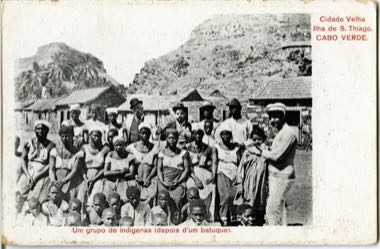

# Batuque Cloth-Drum Circle

*Batuque (Santiago, Cabo Verde)*

**Encyclopedia ID 1251** (permanent) · https://equalinformation.com/world-heritage-games-site/games/1251-batuque-cloth-drum-circle/

*Photo: unknown, early 20th century postcard, [Public domain](https://creativecommons.org/publicdomain/mark/1.0/), [source on Wikimedia Commons](https://commons.wikimedia.org/wiki/File:JRD_-_Cidade_Velha,_Ilha_de_S._Thiago,_Cabo_Verde_–_Um_grupo_de_indígenas_(depois_d'um_batuque).jpg)*

Beat tight cloth bundles clamped between the thighs in a polyrhythm while a leader sings a call, and answer each phrase with the group's pattern.

## Heritage note

Part of the living heritage of Cape Verde. Some forms of this practice carry deep meaning for the communities who keep it; here we describe the play and the craft only, with respect for its roots.

## Origins

A living tradition passed from person to person; it is not tied to a single dated origin. It belongs to the cultural world of Africa: Sahel, West and Central.

## Facts

- **Where:** Cape Verde
- **Type:** Musical instruments
- **Family:** Drums and percussion
- **Era:** [Living Traditions](../../eras/living/index.md)
- **Cradle:** [Africa: Sahel, West and Central](../../cradles/africa-west/index.md)
- **Region:** Sub-Saharan Africa

## Related entries

- [Talking drum](../../games/33-talking-drum/index.md)
- [Calabash Water Drum](../../games/180-calabash-water-drum/index.md)
- [Marimba](../../games/52-marimba/index.md)
- [Amadinda and embaire](../../games/185-amadinda-and-embaire/index.md)
- [Tombak goblet drum rhythms](../../games/233-tombak-goblet-drum-rhythms/index.md)
- [Dhol drum rhythm](../../games/263-dhol-drum-rhythm/index.md)

## Sources

- <https://commons.wikimedia.org/wiki/File:JRD_-_Cidade_Velha,_Ilha_de_S._Thiago,_Cabo_Verde_–_Um_grupo_de_indígenas_(depois_d'um_batuque).jpg>
