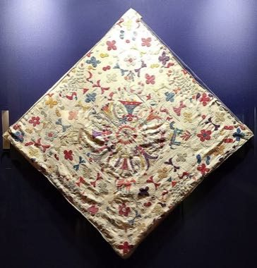

# Chamba rumal embroidery

*चम्बा रूमाल*

**Encyclopedia ID 1252** (permanent) · https://equalinformation.com/world-heritage-games-site/games/1252-chamba-rumal-embroidery/

*Photo: Brahmavadini, [CC BY-SA 4.0](https://creativecommons.org/licenses/by-sa/4.0/), [source on Wikimedia Commons](https://commons.wikimedia.org/wiki/File:19th_Century_Chamba_Rumal.jpg)*

Stitch matching mirror-image double-satin flowers, birds and trees onto fine cotton so the pattern looks identical on both sides, following a drawn outline.

## Heritage note

Part of the living heritage of India.

## Origins

A living tradition passed from person to person; it is not tied to a single dated origin. It belongs to the cultural world of South Asia.

## Facts

- **Where:** India
- **Type:** Crafts and making
- **Family:** Textile and weaving crafts
- **Era:** [Living Traditions](../../eras/living/index.md)
- **Cradle:** [South Asia](../../cradles/south-asia/index.md)
- **Region:** South and Central Asia

## Related entries

- [Phulkari darn-stitch embroidery](../../games/257-phulkari-darn-stitch-embroidery/index.md)
- [Bandhani tie-dye](../../games/258-bandhani-tie-dye/index.md)
- [Jaapi weaving](../../games/1304-jaapi-weaving/index.md)
- [Ralli patchwork quilt](../../games/1364-ralli-patchwork-quilt/index.md)
- [Dhaka weave pattern loom](../../games/115-dhaka-weave-pattern-loom/index.md)
- [Kantha running-stitch quilt](../../games/284-kantha-running-stitch-quilt/index.md)

## Sources

- <https://commons.wikimedia.org/wiki/File:19th_Century_Chamba_Rumal.jpg>
