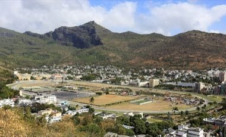

# Champ de Mars turf

*Champ de Mars turf (island horse racing) · island horse racing*

**Encyclopedia ID 1253** (permanent) · https://equalinformation.com/world-heritage-games-site/games/1253-champ-de-mars-turf/

*Photo: Martin Falbisoner, [CC BY-SA 4.0](https://creativecommons.org/licenses/by-sa/4.0/), [source on Wikimedia Commons](https://commons.wikimedia.org/wiki/File:The_Champ_de_Mars_Racecourse.JPG)*

Train and time a horse around the oval of the Port Louis racecourse, balancing pace and the final sprint.

## Heritage note

Part of the living heritage of Mauritius. Animals are partners in this tradition; good care and local rules always come first.

## Origins

Usually placed in the era of Classical Worlds (about 1000 BCE to 500 CE), although its exact origins are uncertain, within the cultural world of Africa: Great Lakes and Indian Ocean.

## Facts

- **Where:** Mauritius
- **Type:** Sports with animal partners
- **Family:** Horse and animal sports
- **Era:** [Classical Worlds](../../eras/classical/index.md) (uncertain)
- **Cradle:** [Africa: Great Lakes and Indian Ocean](../../cradles/africa-east/index.md)
- **Region:** Sub-Saharan Africa

## Related entries

- [Cirit](../../games/156-cirit/index.md)
- [Tbourida](../../games/164-tbourida/index.md)
- [Equestrian vaulting](../../games/488-equestrian-vaulting/index.md)
- [Encang kuda](../../games/1067-encang-kuda/index.md)
- [Slovene quintain](../../games/1073-slovene-quintain/index.md)
- [Turkmen Akhal-Teke equestrian games](../../games/1170-turkmen-akhal-teke-equestrian-games/index.md)

## Sources

- <https://commons.wikimedia.org/wiki/File:The_Champ_de_Mars_Racecourse.JPG>
