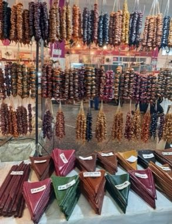

# Churchkhela

*ჩურჩხელა · Georgian string-and-nut candle*

**Encyclopedia ID 1255** (permanent) · https://equalinformation.com/world-heritage-games-site/games/1255-churchkhela/

*Photo: Helen Owl, [CC BY-SA 4.0](https://creativecommons.org/licenses/by-sa/4.0/), [source on Wikimedia Commons](https://commons.wikimedia.org/wiki/File:Churchkhela_on_the_market.jpg)*

String walnuts and dip them repeatedly into thick grape juice batter, timing the dips and drying to make straight even strings.

## Heritage note

Part of the living heritage of Georgia. Some forms of this practice carry deep meaning for the communities who keep it; here we describe the play and the craft only, with respect for its roots.

## Origins

A living tradition passed from person to person; it is not tied to a single dated origin. It belongs to the cultural world of Persia, Caucasus and Central Asia.

## Facts

- **Where:** Georgia
- **Type:** Crafts and making
- **Family:** String instruments
- **Era:** [Living Traditions](../../eras/living/index.md)
- **Cradle:** [Persia, Caucasus and Central Asia](../../cradles/persia-central-asia/index.md)
- **Region:** Europe

## Related entries

- [Santur Hammer Strings](../../games/138-santur-hammer-strings/index.md)
- [Dan bau](../../games/143-dan-bau/index.md)
- [Santoor](../../games/151-santoor/index.md)
- [Goje One-String Fiddle](../../games/176-goje-one-string-fiddle/index.md)
- [Masenqo and the azmari](../../games/187-masenqo-and-the-azmari/index.md)
- [Hira gasy village troupe contest](../../games/205-hira-gasy-village-troupe-contest/index.md)

## Sources

- <https://commons.wikimedia.org/wiki/File:Churchkhela_on_the_market.jpg>
