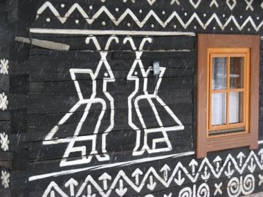

# Čičmany House Ornament Painting

*Also known as: Čičmianske ornamenty*

**Encyclopedia ID 1256** (permanent) · https://bpupadhyaya.github.io/world-heritage-games-site/games/1256-cicmany-house-ornament-painting/

*Photo: Szombat78, [CC0](https://creativecommons.org/publicdomain/zero/1.0/), [source on Wikimedia Commons](https://commons.wikimedia.org/wiki/File:Wooden_house,_%C4%8Ci%C4%8Dmany,_Slovakia.jpg)*

Draw white geometric symbols and bird figures on a dark log-house wall following the embroidery grammar of Čičmany, matching a pattern shown to you.

## Heritage note

Part of the living heritage of Slovakia.

## Origins

A living tradition passed from person to person; it is not tied to a single dated origin. It belongs to the cultural world of Northern and Eastern Europe.

## Facts

- **Where:** Slovakia
- **Type:** Crafts and making
- **Family:** Paper, ink and painting crafts
- **Era:** [Living Traditions](../../eras/living/index.md)
- **Cradle:** [Northern and Eastern Europe](../../cradles/north-east-europe/index.md)
- **Region:** Europe

## Related entries

- [Matryoshka](../../games/28-matryoshka/index.md)
- [Khokhloma Pattern Painting](../../games/102-khokhloma-pattern-painting/index.md)
- [Rosemaling](../../games/120-rosemaling/index.md)
- [Petrykivka painting](../../games/381-petrykivka-painting/index.md)
- [Kalocsa floral painting](../../games/383-kalocsa-floral-painting/index.md)
- [Dala Horse Painting](../../games/415-dala-horse-painting/index.md)

## Sources

- <https://commons.wikimedia.org/wiki/File:Wooden_house,_%C4%8Ci%C4%8Dmany,_Slovakia.jpg>
