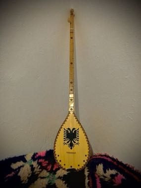

# Çiftelia

*Çiftelia · two-string folk lute*

**Encyclopedia ID 1257** (permanent) · https://equalinformation.com/world-heritage-games-site/games/1257-ciftelia/

*Photo: A.jobs02, [CC BY-SA 4.0](https://creativecommons.org/licenses/by-sa/4.0/), [source on Wikimedia Commons](https://commons.wikimedia.org/wiki/File:Çifteli_2021.jpg)*

Pluck the melody string while the drone string keeps time, matching falling notes in a bright highland song.

## Heritage note

Part of the living heritage of Albania.

## Origins

Usually placed in the era of Crossroads and Golden Ages (about 500 to 1500), although its exact origins are uncertain, within the cultural world of Mediterranean.

## Facts

- **Where:** Albania
- **Type:** Musical instruments
- **Family:** String instruments
- **Era:** [Crossroads and Golden Ages](../../eras/crossroads/index.md) (uncertain)
- **Cradle:** [Mediterranean](../../cradles/mediterranean/index.md)
- **Region:** Europe

## Related entries

- [Dombra](../../games/48-dombra/index.md)
- [Charango](../../games/55-charango/index.md)
- [Erhu Two-String Fiddle](../../games/139-erhu-two-string-fiddle/index.md)
- [Buzuq Long-Neck Lute](../../games/218-buzuq-long-neck-lute/index.md)
- [Komuz](../../games/242-komuz/index.md)
- [Saz / Bağlama](../../games/243-saz-baglama/index.md)

## Sources

- <https://commons.wikimedia.org/wiki/File:Çifteli_2021.jpg>
