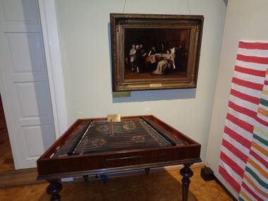

# Cimbalom

*Cimbalom · Hammered Dulcimer*

**Encyclopedia ID 1258** (permanent) · https://equalinformation.com/world-heritage-games-site/games/1258-cimbalom/

*Photo: Sir Morosus, [CC BY-SA 4.0](https://creativecommons.org/licenses/by-sa/4.0/), [source on Wikimedia Commons](https://commons.wikimedia.org/wiki/File:Hammered_dulcimer_-_Omaszta_House,_B%C3%A9k%C3%A9scsaba,_Hungary.jpg)*

Strike strings with two mallets, following scrolling notes on the trapezoid layout, building tremolos and ornamented runs.

## Heritage note

Part of the living heritage of Hungary.

## Origins

A living tradition passed from person to person; it is not tied to a single dated origin. It belongs to the cultural world of Northern and Eastern Europe.

## Facts

- **Where:** Hungary
- **Type:** Musical instruments
- **Family:** String instruments
- **Era:** [Living Traditions](../../eras/living/index.md)
- **Cradle:** [Northern and Eastern Europe](../../cradles/north-east-europe/index.md)
- **Region:** Europe

## Related entries

- [Hardanger Fiddle Halling](../../games/520-hardanger-fiddle-halling/index.md)
- [Gadulka](../../games/1285-gadulka/index.md)
- [Gusle Bow and Verse](../../games/1294-gusle-bow-and-verse/index.md)
- [Santur Hammer Strings](../../games/138-santur-hammer-strings/index.md)
- [Dan bau](../../games/143-dan-bau/index.md)
- [Santoor](../../games/151-santoor/index.md)

## Sources

- <https://commons.wikimedia.org/wiki/File:Hammered_dulcimer_-_Omaszta_House,_B%C3%A9k%C3%A9scsaba,_Hungary.jpg>
