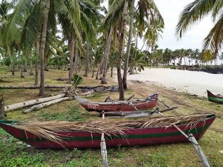

# Ngalawa outrigger sailing

*Also known as: Ngalawa outrigger sailing (Comoros) · Comoros*

**Encyclopedia ID 1259** (permanent) · https://bpupadhyaya.github.io/world-heritage-games-site/games/1259-ngalawa-outrigger-sailing/

*Photo: Radosław Botev, CC BY 3.0 pl, [source on Wikimedia Commons](https://commons.wikimedia.org/wiki/File:Mitsamiouli_beach_pirogues_Comoros.jpg)*

Balance an outrigger canoe in the swell, trimming a sail to catch the monsoon wind, steering between reefs to bring the day's fish to the beach.

## Heritage note

Part of the living heritage of Comoros.

## Origins

Usually placed in the era of Age of Contact and Craft (about 1500 to 1800), although its exact origins are uncertain, within the cultural world of Africa: Great Lakes and Indian Ocean.

## Facts

- **Where:** Comoros
- **Type:** Racing
- **Family:** Water sports
- **Era:** [Age of Contact and Craft](../../eras/contact/index.md) (uncertain)
- **Cradle:** [Africa: Great Lakes and Indian Ocean](../../cradles/africa-east/index.md)
- **Region:** Sub-Saharan Africa

## Related entries

- [Nouka Baich](../../games/42-nouka-baich/index.md)
- [Pirogue coastal canoe race](../../games/56-pirogue-coastal-canoe-race/index.md)
- [Nile Felucca Sailing](../../games/216-nile-felucca-sailing/index.md)
- [Shikara paddle race](../../games/265-shikara-paddle-race/index.md)
- [Hanetsuki](../../games/347-hanetsuki/index.md)
- [Venetian lagoon regatta](../../games/486-venetian-lagoon-regatta/index.md)

## Sources

- <https://commons.wikimedia.org/wiki/File:Mitsamiouli_beach_pirogues_Comoros.jpg>
