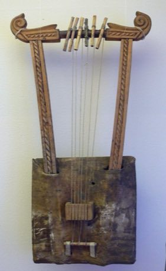

# Krar lyre

*Also known as: Krar*

**Encyclopedia ID 126** (permanent) · https://bpupadhyaya.github.io/world-heritage-games-site/games/126-krar-lyre/

*Photo: User:KarlHeinrich, [Public domain](https://creativecommons.org/publicdomain/mark/1.0/), [source on Wikimedia Commons](https://commons.wikimedia.org/wiki/File:Krar_Linden-Museum_F55878.jpg)*

Pluck a five or six-string bowl lyre to follow notes through pentatonic scales, then compose small songs.

## Heritage note

Part of the living heritage of Ethiopia, Eritrea.

## Origins

Usually placed in the era of Classical Worlds (about 1000 BCE to 500 CE), although its exact origins are uncertain, within the cultural world of Africa: Nile and the Horn.

## Facts

- **Where:** Ethiopia, Eritrea
- **Type:** Musical instruments
- **Family:** String instruments
- **Era:** [Classical Worlds](../../eras/classical/index.md) (uncertain)
- **Cradle:** [Africa: Nile and the Horn](../../cradles/africa-nile/index.md)
- **Region:** Sub-Saharan Africa

## Play it

[Try a 90-second preview in your browser](https://bpupadhyaya.github.io/games-site/games/krar-lyre/play/) · [Google Play](https://play.google.com/store/apps/details?id=com.equalinformation.arcforge.shell) · [App Store](https://apps.apple.com/us/app/arcforge-world-heritage-games/id6813746442)

## Related entries

- [Begena](../../games/7301-begena/index.md)
- [Zande kundi arched harp](../../games/1319-zande-kundi-arched-harp/index.md)
- [Kissar](../../games/2889-kissar/index.md)
- [Simsimiyya](../../games/6047-simsimiyya/index.md)
- [Tanbura](../../games/6048-tanbura/index.md)
- [Morin khuur](../../games/34-morin-khuur/index.md)

## Sources

- <https://commons.wikimedia.org/wiki/File:Krar_Linden-Museum_F55878.jpg>
