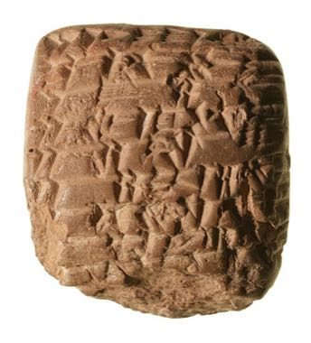

# Cuneiform Clay Tablet Scribe

*Also known as: Cuneiform · مسمارية*

**Encyclopedia ID 1260** (permanent) · https://bpupadhyaya.github.io/world-heritage-games-site/games/1260-cuneiform-clay-tablet-scribe/

*Photo: Original author unknown. Translation help provided by Manuel Molina., [Public domain](https://creativecommons.org/publicdomain/mark/1.0/), [source on Wikimedia Commons](https://commons.wikimedia.org/wiki/File:Cuneiform_Akkadian_clay_tablet_1.jpg)*

Press a reed stylus into wet clay at the right angles to form wedge signs and complete a record tablet before it dries.

## Heritage note

Part of the living heritage of Iraq.

## Origins

A living tradition passed from person to person; it is not tied to a single dated origin. It belongs to the cultural world of Mesopotamia, Levant and Arabia.

## Facts

- **Where:** Iraq
- **Type:** Crafts and making
- **Family:** Wind instruments
- **Era:** [Living Traditions](../../eras/living/index.md)
- **Cradle:** [Mesopotamia, Levant and Arabia](../../cradles/mesopotamia-levant/index.md)
- **Region:** Middle East and North Africa

## Related entries

- [Mudhif reed-arch house](../../games/230-mudhif-reed-arch-house/index.md)
- [Mijwiz Double Clarinet](../../games/221-mijwiz-double-clarinet/index.md)
- [Khene](../../games/145-khene/index.md)
- [Lusheng](../../games/337-lusheng/index.md)
- [Launeddas Triple Pipe](../../games/400-launeddas-triple-pipe/index.md)
- [Rubboard zydeco rhythm](../../games/437-rubboard-zydeco-rhythm/index.md)

## Sources

- <https://commons.wikimedia.org/wiki/File:Cuneiform_Akkadian_clay_tablet_1.jpg>
