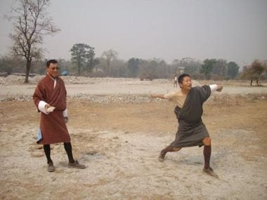

# Digor

*དྲིག་གོར། · Bhutanese stone throw*

**Encyclopedia ID 1267** (permanent) · https://equalinformation.com/world-heritage-games-site/games/1267-digor/

*Photo: Kencho Thinley, [Public domain](https://creativecommons.org/publicdomain/mark/1.0/), [source on Wikimedia Commons](https://commons.wikimedia.org/wiki/File:Playing_Degor.JPG)*

Two teams hurl flat round stones about 20 metres at a peg in the ground; the stone landing within a hand-span of the peg scores, and you may knock rivals away.

## Heritage note

Part of the living heritage of Bhutan.

## Origins

Usually placed in the era of Classical Worlds (about 1000 BCE to 500 CE), although its exact origins are uncertain, within the cultural world of South Asia.

## Facts

- **Where:** Bhutan
- **Type:** Archery, throwing and target games
- **Era:** [Classical Worlds](../../eras/classical/index.md) (uncertain)
- **Cradle:** [South Asia](../../cradles/south-asia/index.md)
- **Region:** South and Central Asia

## Related entries

- [Archery](../../games/591-archery/index.md)
- [Kotta Pora](../../games/18-kotta-pora/index.md)
- [Kathputli string puppets](../../games/79-kathputli-string-puppets/index.md)
- [Silambam](../../games/271-silambam/index.md)
- [Stilt fishing](../../games/288-stilt-fishing/index.md)
- [Murchunga](../../games/290-murchunga/index.md)

## Sources

- <https://commons.wikimedia.org/wiki/File:Playing_Degor.JPG>
