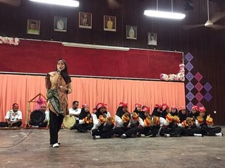

# Dikir barat

*dikir barat*

**Encyclopedia ID 1268** (permanent) · https://equalinformation.com/world-heritage-games-site/games/1268-dikir-barat/

*Photo: SMK SERI MAHKOTA, [CC BY-SA 4.0](https://creativecommons.org/licenses/by-sa/4.0/), [source on Wikimedia Commons](https://commons.wikimedia.org/wiki/File:Dikir_barat.jpg)*

A caller improvises verses and the seated chorus answers with clapping and swaying patterns; the player repeats clap-sway sequences in time with the caller and chorus.

## Heritage note

Part of the living heritage of Malaysia.

## Origins

Usually placed in the era of Modern Heritage (1800 to today), although its exact origins are uncertain, within the cultural world of Southeast Asia and the Islands.

## Facts

- **Where:** Malaysia
- **Type:** Street and playground games
- **Family:** Rhyme and hand games
- **Era:** [Modern Heritage](../../eras/modern/index.md) (uncertain)
- **Cradle:** [Southeast Asia and the Islands](../../cradles/southeast-asia/index.md)
- **Region:** East and Southeast Asia

## Related entries

- [Cublak-cublak suweng](../../games/325-cublak-cublak-suweng/index.md)
- [Double Dutch](../../games/53-double-dutch/index.md)
- [Woggabaliri](../../games/561-woggabaliri/index.md)
- [Finger pulling](../../games/563-finger-pulling/index.md)
- [Kriol traditional games](../../games/585-kriol-traditional-games/index.md)
- [Lato-lato](../../games/316-lato-lato/index.md)

## Sources

- <https://commons.wikimedia.org/wiki/File:Dikir_barat.jpg>
