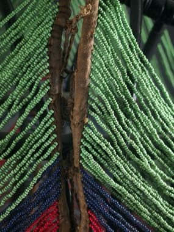

# Dinka beaded corset beadwork

*Dinka beadwork*

**Encyclopedia ID 1269** (permanent) · https://bpupadhyaya.github.io/world-heritage-games-site/games/1269-dinka-beaded-corset-beadwork/

*Photo: Ann Porteus from Tasmania, Australia, [CC BY 2.0](https://creativecommons.org/licenses/by/2.0/), [source on Wikimedia Commons](https://commons.wikimedia.org/wiki/File:P2243791j_detail_Dinka_Mans_beaded_Corset,_Southern_Sudan_(8501740737).jpg)*

Thread coloured beads in rows to match a pattern and build a corset in layers of colour.

## Heritage note

Part of the living heritage of South Sudan.

## Origins

A living tradition passed from person to person; it is not tied to a single dated origin. It belongs to the cultural world of Africa: Nile and the Horn.

## Facts

- **Where:** South Sudan
- **Type:** Crafts and making
- **Family:** Paper, ink and painting crafts
- **Era:** [Living Traditions](../../eras/living/index.md)
- **Cradle:** [Africa: Nile and the Horn](../../cradles/africa-nile/index.md)
- **Region:** Sub-Saharan Africa

## Related entries

- [Nubian house painting](../../games/192-nubian-house-painting/index.md)
- [Khayamiya Tentmaker Applique](../../games/217-khayamiya-tentmaker-applique/index.md)
- [Ebru paper marbling](../../games/20-ebru-paper-marbling/index.md)
- [Ndebele geometric wall painting](../../games/23-ndebele-geometric-wall-painting/index.md)
- [Chinese knotting](../../games/26-chinese-knotting/index.md)
- [Matryoshka](../../games/28-matryoshka/index.md)

## Sources

- <https://commons.wikimedia.org/wiki/File:P2243791j_detail_Dinka_Mans_beaded_Corset,_Southern_Sudan_(8501740737).jpg>
