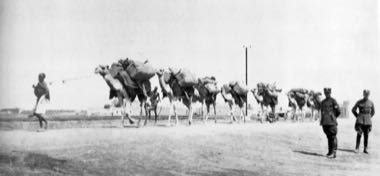

# Horn of Africa camel caravan

*Also known as: Karawan*

**Encyclopedia ID 1270** (permanent) · https://bpupadhyaya.github.io/world-heritage-games-site/games/1270-horn-of-africa-camel-caravan/

*Photo: CZ: František Vopat (* 1. dubna 1877 Černíkovice okres Kralovice – 1945) – dělos, [Public domain](https://creativecommons.org/publicdomain/mark/1.0/), [source on Wikimedia Commons](https://commons.wikimedia.org/wiki/File:Velbloudi_Kravana_v_Djibuti_January_1920.png)*

Lead a camel string across desert wells, balancing water, load and pace.

## Heritage note

Part of the living heritage of Djibouti. Animals are partners in this tradition; good care and local rules always come first.

## Origins

Usually placed in the era of Crossroads and Golden Ages (about 500 to 1500), although its exact origins are uncertain, within the cultural world of Africa: Nile and the Horn.

## Facts

- **Where:** Djibouti
- **Type:** Musical instruments
- **Family:** Wind instruments
- **Era:** [Crossroads and Golden Ages](../../eras/crossroads/index.md) (uncertain)
- **Cradle:** [Africa: Nile and the Horn](../../cradles/africa-nile/index.md)
- **Region:** Sub-Saharan Africa

## Related entries

- [Highland Bagpipe Chanter and Drone](../../games/510-highland-bagpipe-chanter-and-drone/index.md)
- [Latvian Bagpipe and Folk Pipes](../../games/1324-latvian-bagpipe-and-folk-pipes/index.md)
- [Mezoued Bagpipe and Tabl Drum](../../games/1336-mezoued-bagpipe-and-tabl-drum/index.md)
- [Lake Assal salt harvest](../../games/1321-lake-assal-salt-harvest/index.md)
- [Wazza gourd trumpet](../../games/1399-wazza-gourd-trumpet/index.md)
- [Ladu](../../games/674-ladu/index.md)

## Sources

- <https://commons.wikimedia.org/wiki/File:Velbloudi_Kravana_v_Djibuti_January_1920.png>
