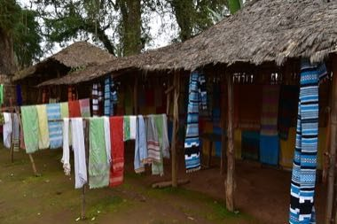

# Dorze cotton weaving

*Dorze shamma*

**Encyclopedia ID 1271** (permanent) · https://bpupadhyaya.github.io/world-heritage-games-site/games/1271-dorze-cotton-weaving/

*Photo: Richard Mortel from Riyadh, Saudi Arabia, [CC BY 2.0](https://creativecommons.org/licenses/by/2.0/), [source on Wikimedia Commons](https://commons.wikimedia.org/wiki/File:Dorze_cotton_weavings_for_sale_(1)_(28519736133).jpg)*

Set the loom and weave stripes of coloured thread to a pattern.

## Heritage note

Part of the living heritage of Ethiopia.

## Origins

A living tradition passed from person to person; it is not tied to a single dated origin. It belongs to the cultural world of Africa: Nile and the Horn.

## Facts

- **Where:** Ethiopia
- **Type:** Crafts and making
- **Family:** Textile and weaving crafts
- **Era:** [Living Traditions](../../eras/living/index.md)
- **Cradle:** [Africa: Nile and the Horn](../../cradles/africa-nile/index.md)
- **Region:** Sub-Saharan Africa

## Related entries

- [Mesob basket weaving](../../games/1335-mesob-basket-weaving/index.md)
- [Kente strip weaving](../../games/22-kente-strip-weaving/index.md)
- [Celtic knot weave](../../games/25-celtic-knot-weave/index.md)
- [Sashiko Stitch Patterns](../../games/27-sashiko-stitch-patterns/index.md)
- [Adire indigo resist dyeing](../../games/87-adire-indigo-resist-dyeing/index.md)
- [Agaseke basket weaving](../../games/89-agaseke-basket-weaving/index.md)

## Sources

- <https://commons.wikimedia.org/wiki/File:Dorze_cotton_weavings_for_sale_(1)_(28519736133).jpg>
