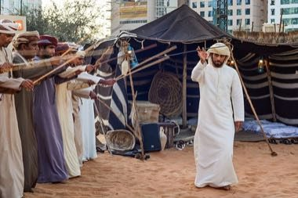

# Al Ayyala Cane-Line Rhythm

*Also known as: العيالة*

**Encyclopedia ID 1272** (permanent) · https://bpupadhyaya.github.io/world-heritage-games-site/games/1272-al-ayyala-cane-line-rhythm/

*Photo: Rashed AlSumaiti, [CC BY-SA 4.0](https://creativecommons.org/licenses/by-sa/4.0/), [source on Wikimedia Commons](https://commons.wikimedia.org/wiki/File:Ayyala.jpg)*

Two lines of performers sway and throw canes in time with drumming.

## Heritage note

Part of the living heritage of United Arab Emirates.

## Origins

Usually placed in the era of Classical Worlds (about 1000 BCE to 500 CE), although its exact origins are uncertain, within the cultural world of Mesopotamia, Levant and Arabia.

## Facts

- **Where:** United Arab Emirates
- **Type:** Archery, throwing and target games
- **Family:** Tag, chase and hide games
- **Era:** [Classical Worlds](../../eras/classical/index.md) (uncertain)
- **Cradle:** [Mesopotamia, Levant and Arabia](../../cradles/mesopotamia-levant/index.md)
- **Region:** Middle East and North Africa

## Related entries

- [Moraingy drum-and-strike duel](../../games/207-moraingy-drum-and-strike-duel/index.md)
- [Circle Dodgeball](../../games/470-circle-dodgeball/index.md)
- [Kyz Kuu](../../games/858-kyz-kuu/index.md)
- [Kalinda Stick Duel](../../games/1467-kalinda-stick-duel/index.md)
- [Blind Man's Buff](../../games/467-blind-mans-buff/index.md)
- [Kho-Kho](../../games/15-kho-kho/index.md)

## Sources

- <https://commons.wikimedia.org/wiki/File:Ayyala.jpg>
