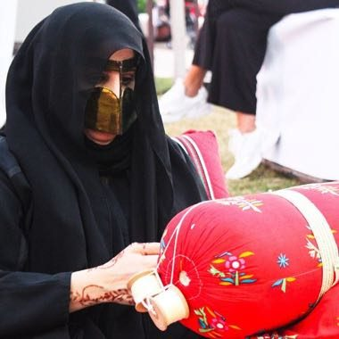

# Al Talli Braid Embroidery

*Also known as: التلي*

**Encyclopedia ID 1273** (permanent) · https://bpupadhyaya.github.io/world-heritage-games-site/games/1273-al-talli-braid-embroidery/

*Photo: Kaiser Firdhous, [CC BY-SA 4.0](https://creativecommons.org/licenses/by-sa/4.0/), [source on Wikimedia Commons](https://commons.wikimedia.org/wiki/File:AbuDhabi_Women's_Handicrafts.jpg)*

Wind metallic threads over a bobbin pillow to braid shiny ribbon in a given pattern; the braid is sewn onto a garment.

## Heritage note

Part of the living heritage of United Arab Emirates.

## Origins

A living tradition passed from person to person; it is not tied to a single dated origin. It belongs to the cultural world of Mesopotamia, Levant and Arabia.

## Facts

- **Where:** United Arab Emirates
- **Type:** Crafts and making
- **Family:** Textile and weaving crafts
- **Era:** [Living Traditions](../../eras/living/index.md)
- **Cradle:** [Mesopotamia, Levant and Arabia](../../cradles/mesopotamia-levant/index.md)
- **Region:** Middle East and North Africa

## Related entries

- [Tatreez Palestinian Cross-Stitch](../../games/212-tatreez-palestinian-cross-stitch/index.md)
- [Sadu Bedouin ground-loom weaving](../../games/238-sadu-bedouin-ground-loom-weaving/index.md)
- [Gargoor Fish-Trap Weaving](../../games/1288-gargoor-fish-trap-weaving/index.md)
- [Gulf Dhow Hull Builder](../../games/1293-gulf-dhow-hull-builder/index.md)
- [Kente strip weaving](../../games/22-kente-strip-weaving/index.md)
- [Celtic knot weave](../../games/25-celtic-knot-weave/index.md)

## Sources

- <https://commons.wikimedia.org/wiki/File:AbuDhabi_Women's_Handicrafts.jpg>
