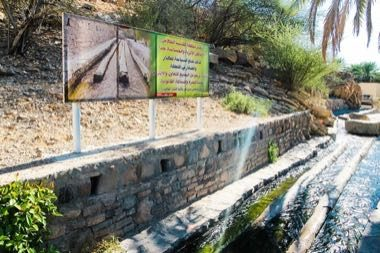

# Falaj Water-Turn Clock

*Also known as: فلج · aflaj shares*

**Encyclopedia ID 1274** (permanent) · https://bpupadhyaya.github.io/world-heritage-games-site/games/1274-falaj-water-turn-clock/

*Photo: Dr. Thomas Liptak, [CC BY-SA 4.0](https://creativecommons.org/licenses/by-sa/4.0/), [source on Wikimedia Commons](https://commons.wikimedia.org/wiki/File:Oman,_Birkat_Al-Mawz,_Falaj_Al_Khatmeen.jpg)*

Open and close sluice gates along a gravity channel and read sundial and star shadows so every farm gets its allotted share of water in the right hour.

## Heritage note

Part of the living heritage of Oman.

## Origins

Usually placed in the era of Classical Worlds (about 1000 BCE to 500 CE), although its exact origins are uncertain, within the cultural world of Mesopotamia, Levant and Arabia.

## Facts

- **Where:** Oman
- **Type:** Board and table games
- **Era:** [Classical Worlds](../../eras/classical/index.md) (uncertain)
- **Cradle:** [Mesopotamia, Levant and Arabia](../../cradles/mesopotamia-levant/index.md)
- **Region:** Middle East and North Africa

## Related entries

- [Cirit](../../games/156-cirit/index.md)
- [Qanun](../../games/162-qanun/index.md)
- [Al Ayyala Cane-Line Rhythm](../../games/1272-al-ayyala-cane-line-rhythm/index.md)
- [Okey](../../games/1158-okey/index.md)
- [Omani Khanjar Silver Filigree](../../games/1351-omani-khanjar-silver-filigree/index.md)
- [Hawalis](../../games/1001-hawalis/index.md)

## Sources

- <https://commons.wikimedia.org/wiki/File:Oman,_Birkat_Al-Mawz,_Falaj_Al_Khatmeen.jpg>
