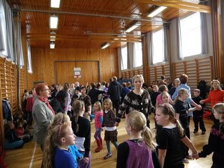

# Faroese chain dance

*Føroyskur dansur · Faroese ballads*

**Encyclopedia ID 1276** (permanent) · https://bpupadhyaya.github.io/world-heritage-games-site/games/1276-faroese-chain-dance/

*Photo: EileenSanda, [CC BY-SA 3.0](https://creativecommons.org/licenses/by-sa/3.0/), [source on Wikimedia Commons](https://commons.wikimedia.org/wiki/File:Faroese_Chain_Dance_in_Eidi_2010.JPG)*

Join a linked ring, take two steps left and one back in time with a sung ballad, keeping the chain unbroken through verse and refrain.

## Heritage note

Part of the living heritage of Denmark. Some forms of this practice carry deep meaning for the communities who keep it; here we describe the play and the craft only, with respect for its roots.

## Origins

A living tradition passed from person to person; it is not tied to a single dated origin. It belongs to the cultural world of Northern and Eastern Europe.

## Facts

- **Where:** Denmark
- **Type:** Dances
- **Family:** Folk and line dances
- **Era:** [Living Traditions](../../eras/living/index.md)
- **Cradle:** [Northern and Eastern Europe](../../cradles/north-east-europe/index.md)
- **Region:** Europe

## Related entries

- [Dabke line dance](../../games/37-dabke-line-dance/index.md)
- [Gumboot dance rhythm](../../games/123-gumboot-dance-rhythm/index.md)
- [Tahtib](../../games/157-tahtib/index.md)
- [Eskista](../../games/188-eskista/index.md)
- [Jebena coffee brewing](../../games/189-jebena-coffee-brewing/index.md)
- [Cueca](../../games/430-cueca/index.md)

## Sources

- <https://commons.wikimedia.org/wiki/File:Faroese_Chain_Dance_in_Eidi_2010.JPG>
