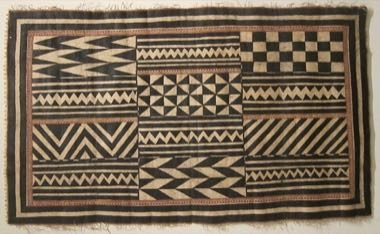

# Masi bark-cloth stencil printing

*Masi*

**Encyclopedia ID 1279** (permanent) · https://bpupadhyaya.github.io/world-heritage-games-site/games/1279-masi-bark-cloth-stencil-printing/

*Photo: Hiart, [CC0](https://creativecommons.org/publicdomain/zero/1.0/), [source on Wikimedia Commons](https://commons.wikimedia.org/wiki/File:Masi_(barkcloth)_from_Fiji,_Honolulu_Museum_of_Art.JPG)*

Lay a pattern stencil on bark cloth and rub in black and rust-brown dyes; align repeats to complete bold geometric bands without gaps.

## Heritage note

Part of the living heritage of Fiji.

## Origins

A living tradition passed from person to person; it is not tied to a single dated origin. It belongs to the cultural world of Pacific and Oceania.

## Facts

- **Where:** Fiji
- **Type:** Crafts and making
- **Family:** Paper, ink and painting crafts
- **Era:** [Living Traditions](../../eras/living/index.md)
- **Cradle:** [Pacific and Oceania](../../cradles/pacific/index.md)
- **Region:** Oceania and Pacific

## Related entries

- [Lei making](../../games/449-lei-making/index.md)
- [Pandanus mat plaiting](../../games/1313-pandanus-mat-plaiting/index.md)
- [Ngatu bark-cloth pattern rubbing](../../games/1385-ngatu-bark-cloth-pattern-rubbing/index.md)
- [Ebru paper marbling](../../games/20-ebru-paper-marbling/index.md)
- [Ndebele geometric wall painting](../../games/23-ndebele-geometric-wall-painting/index.md)
- [Chinese knotting](../../games/26-chinese-knotting/index.md)

## Sources

- <https://commons.wikimedia.org/wiki/File:Masi_(barkcloth)_from_Fiji,_Honolulu_Museum_of_Art.JPG>
