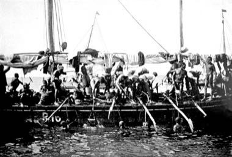

# Fijiri Pearl-Diver Sea Songs

*فجري*

**Encyclopedia ID 1280** (permanent) · https://equalinformation.com/world-heritage-games-site/games/1280-fijiri-pearl-diver-sea-songs/

*Photo: George Frederick Kunz, [Public domain](https://creativecommons.org/publicdomain/mark/1.0/), [source on Wikimedia Commons](https://commons.wikimedia.org/wiki/File:Arab_pearl_divers_in_the_Persian_Gulf.jpg)*

Follow the lead singer's call-and-response and rhythm of clapping, drums and jars as divers haul ropes; accuracy grows the crew's pearl haul.

## Heritage note

Part of the living heritage of Kuwait, Bahrain.

## Origins

A living tradition passed from person to person; it is not tied to a single dated origin. It belongs to the cultural world of Mesopotamia, Levant and Arabia.

## Facts

- **Where:** Kuwait, Bahrain
- **Type:** Musical instruments
- **Family:** Water sports
- **Era:** [Living Traditions](../../eras/living/index.md)
- **Cradle:** [Mesopotamia, Levant and Arabia](../../cradles/mesopotamia-levant/index.md)
- **Region:** Middle East and North Africa

## Related entries

- [Faustball](../../games/485-faustball/index.md)
- [Water Polo Sprint](../../games/1398-water-polo-sprint/index.md)
- [Ice Canoe Race](../../games/1412-ice-canoe-race/index.md)
- [Jangada Sailing](../../games/1413-jangada-sailing/index.md)
- [Bequia Boat and Model Builder](../../games/1440-bequia-boat-and-model-builder/index.md)
- [Ecuavoley](../../games/1450-ecuavoley/index.md)

## Sources

- <https://commons.wikimedia.org/wiki/File:Arab_pearl_divers_in_the_Persian_Gulf.jpg>
