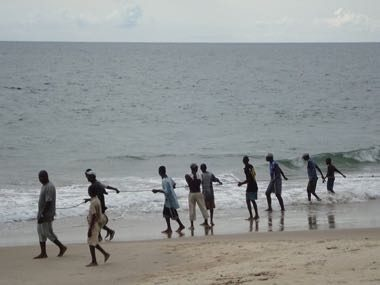

# Freetown Beach Seine Haul

*Beach seine hauling*

**Encyclopedia ID 1282** (permanent) · https://equalinformation.com/world-heritage-games-site/games/1282-freetown-beach-seine-haul/

*Photo: Ghassan Mroue, [CC BY-SA 3.0](https://creativecommons.org/licenses/by-sa/3.0/), [source on Wikimedia Commons](https://commons.wikimedia.org/wiki/File:Zegenvisserij_in_Freetown,_Sierra_Leone,_-2_oktober_2010_a.jpg)*

Two teams on the sand haul on the ropes of a long net in sync with a work-song beat; pull on the beat, read the surf, and bring the catch in before the wave pulls it out.

## Heritage note

Part of the living heritage of Sierra Leone.

## Origins

A living tradition passed from person to person; it is not tied to a single dated origin. It belongs to the cultural world of Africa: Sahel, West and Central.

## Facts

- **Where:** Sierra Leone
- **Type:** Performance and storytelling
- **Family:** Winter sports
- **Era:** [Living Traditions](../../eras/living/index.md)
- **Cradle:** [Africa: Sahel, West and Central](../../cradles/africa-west/index.md)
- **Region:** Sub-Saharan Africa

## Related entries

- [Ikpu Ite Coil Pot](../../games/1300-ikpu-ite-coil-pot/index.md)
- [Wire car](../../games/85-wire-car/index.md)
- [Bamboo scaffold builder](../../games/369-bamboo-scaffold-builder/index.md)
- [Neon sign bender](../../games/371-neon-sign-bender/index.md)
- [Maple taffy on snow](../../games/441-maple-taffy-on-snow/index.md)
- [Dumpling Pleating](../../games/499-dumpling-pleating/index.md)

## Sources

- <https://commons.wikimedia.org/wiki/File:Zegenvisserij_in_Freetown,_Sierra_Leone,_-2_oktober_2010_a.jpg>
