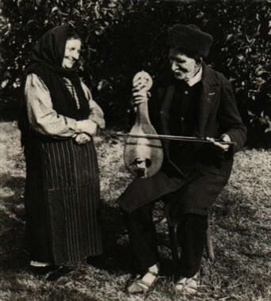

# Gadulka

*Also known as: Гадулка · Bulgarian Bowed Fiddle*

**Encyclopedia ID 1285** (permanent) · https://bpupadhyaya.github.io/world-heritage-games-site/games/1285-gadulka/

*Photo: Unknown authorUnknown author, [Public domain](https://creativecommons.org/publicdomain/mark/1.0/), [source on Wikimedia Commons](https://commons.wikimedia.org/wiki/File:BASA-2072K-1-361-12-Gadulka,_Bulgaria.JPG)*

Bow the three melody strings by fingering with fingernails and keep the sympathetic strings ringing, following asymmetric 7/8 dance rhythms.

## Heritage note

Part of the living heritage of Bulgaria.

## Origins

A living tradition passed from person to person; it is not tied to a single dated origin. It belongs to the cultural world of Northern and Eastern Europe.

## Facts

- **Where:** Bulgaria
- **Type:** Musical instruments
- **Family:** String instruments
- **Era:** [Living Traditions](../../eras/living/index.md)
- **Cradle:** [Northern and Eastern Europe](../../cradles/north-east-europe/index.md)
- **Region:** Europe

## Related entries

- [Hardanger Fiddle Halling](../../games/520-hardanger-fiddle-halling/index.md)
- [Cimbalom](../../games/1258-cimbalom/index.md)
- [Gusle Bow and Verse](../../games/1294-gusle-bow-and-verse/index.md)
- [Santur Hammer Strings](../../games/138-santur-hammer-strings/index.md)
- [Dan bau](../../games/143-dan-bau/index.md)
- [Santoor](../../games/151-santoor/index.md)

## Sources

- <https://commons.wikimedia.org/wiki/File:BASA-2072K-1-361-12-Gadulka,_Bulgaria.JPG>
