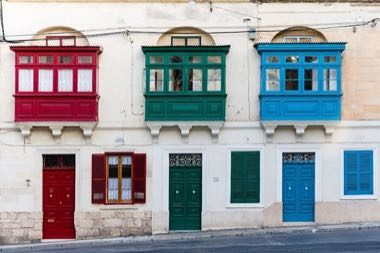

# Gallarija Balcony Builder

*Also known as: Gallarija · Maltese enclosed balconies*

**Encyclopedia ID 1286** (permanent) · https://bpupadhyaya.github.io/world-heritage-games-site/games/1286-gallarija-balcony-builder/

*Photo: CEphoto, Uwe Aranas, [CC BY-SA 3.0](https://creativecommons.org/licenses/by-sa/3.0/), [source on Wikimedia Commons](https://commons.wikimedia.org/wiki/File:Sliema_Malta_Colored-Balconies-01.jpg)*

Assemble panelled, shuttered timber balconies from brackets, glazing bars and bold paint colours to fill a limestone street facade.

## Heritage note

Part of the living heritage of Malta.

## Origins

A living tradition passed from person to person; it is not tied to a single dated origin. It belongs to the cultural world of Mediterranean.

## Facts

- **Where:** Malta
- **Type:** Crafts and making
- **Family:** Paper, ink and painting crafts
- **Era:** [Living Traditions](../../eras/living/index.md)
- **Cradle:** [Mediterranean](../../cradles/mediterranean/index.md)
- **Region:** Europe

## Related entries

- [Luzzu Boat Painter](../../games/1330-luzzu-boat-painter/index.md)
- [Sicilian Cart Painting](../../games/399-sicilian-cart-painting/index.md)
- [Beehive Panel Painter](../../games/1241-beehive-panel-painter/index.md)
- [Licitar Heart Decorator](../../games/1326-licitar-heart-decorator/index.md)
- [Ebru paper marbling](../../games/20-ebru-paper-marbling/index.md)
- [Ndebele geometric wall painting](../../games/23-ndebele-geometric-wall-painting/index.md)

## Sources

- <https://commons.wikimedia.org/wiki/File:Sliema_Malta_Colored-Balconies-01.jpg>
