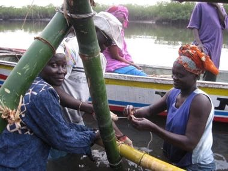

# Gambian Oyster Harvest

*Also known as: Mangrove oyster harvesting*

**Encyclopedia ID 1287** (permanent) · https://bpupadhyaya.github.io/world-heritage-games-site/games/1287-gambian-oyster-harvest/

*Photo: Fajola, [CC BY-SA 4.0](https://creativecommons.org/licenses/by-sa/4.0/), [source on Wikimedia Commons](https://commons.wikimedia.org/wiki/File:Gambian_women_oyster_havesters.jpg)*

Wade into the mangrove at low tide, lift bamboo-and-root racks, pick the ripe oysters, and return before the tide rises, with shell middens growing as a score.

## Heritage note

Part of the living heritage of Gambia.

## Origins

A living tradition passed from person to person; it is not tied to a single dated origin. It belongs to the cultural world of Africa: Sahel, West and Central.

## Facts

- **Where:** Gambia
- **Type:** Crafts and making
- **Era:** [Living Traditions](../../eras/living/index.md)
- **Cradle:** [Africa: Sahel, West and Central](../../cradles/africa-west/index.md)
- **Region:** Sub-Saharan Africa

## Related entries

- [Kashaka](../../games/7183-kashaka/index.md)
- [Kente strip weaving](../../games/22-kente-strip-weaving/index.md)
- [Talking drum](../../games/33-talking-drum/index.md)
- [Bogolan mud cloth](../../games/86-bogolan-mud-cloth/index.md)
- [Adire indigo resist dyeing](../../games/87-adire-indigo-resist-dyeing/index.md)
- [Kuba cloth pattern puzzle](../../games/91-kuba-cloth-pattern-puzzle/index.md)

## Sources

- <https://commons.wikimedia.org/wiki/File:Gambian_women_oyster_havesters.jpg>
