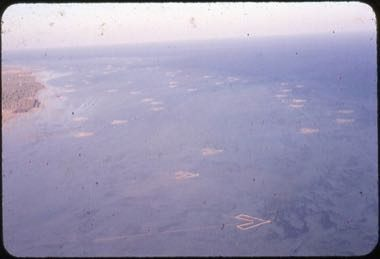

# Gargoor Fish-Trap Weaving

*قرقور*

**Encyclopedia ID 1288** (permanent) · https://equalinformation.com/world-heritage-games-site/games/1288-gargoor-fish-trap-weaving/

*Photo: Cameron, Harry F., [Public domain](https://creativecommons.org/publicdomain/mark/1.0/), [source on Wikimedia Commons](https://commons.wikimedia.org/wiki/File:312_Cameron_fish_traps_in_Bahrain_-_USACE-p15141coll5-15713.jpeg)*

Weave a palm-rib or wire gargoor with the right funnel shape, then place traps on a tide map to catch fish without harming reefs.

## Heritage note

Part of the living heritage of Bahrain.

## Origins

A living tradition passed from person to person; it is not tied to a single dated origin. It belongs to the cultural world of Mesopotamia, Levant and Arabia.

## Facts

- **Where:** Bahrain
- **Type:** Crafts and making
- **Family:** Textile and weaving crafts
- **Era:** [Living Traditions](../../eras/living/index.md)
- **Cradle:** [Mesopotamia, Levant and Arabia](../../cradles/mesopotamia-levant/index.md)
- **Region:** Middle East and North Africa

## Related entries

- [Tatreez Palestinian Cross-Stitch](../../games/212-tatreez-palestinian-cross-stitch/index.md)
- [Sadu Bedouin ground-loom weaving](../../games/238-sadu-bedouin-ground-loom-weaving/index.md)
- [Al Talli Braid Embroidery](../../games/1273-al-talli-braid-embroidery/index.md)
- [Gulf Dhow Hull Builder](../../games/1293-gulf-dhow-hull-builder/index.md)
- [Kente strip weaving](../../games/22-kente-strip-weaving/index.md)
- [Celtic knot weave](../../games/25-celtic-knot-weave/index.md)

## Sources

- <https://commons.wikimedia.org/wiki/File:312_Cameron_fish_traps_in_Bahrain_-_USACE-p15141coll5-15713.jpeg>
