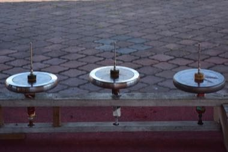

# Gasing uri

*Also known as: giant spinning top*

**Encyclopedia ID 1289** (permanent) · https://bpupadhyaya.github.io/world-heritage-games-site/games/1289-gasing-uri/

*Photo: G.Mannaerts, [CC BY-SA 4.0](https://creativecommons.org/licenses/by-sa/4.0/), [source on Wikimedia Commons](https://commons.wikimedia.org/wiki/File:Spin_kota_Bharu.jpg)*

Wind a thick rope, throw the heavy top so it lands spinning on the platform, and keep it spinning longer than the opponent's.

## Heritage note

Part of the living heritage of Malaysia.

## Origins

Usually placed in the era of Modern Heritage (1800 to today), although its exact origins are uncertain, within the cultural world of Southeast Asia and the Islands.

## Facts

- **Where:** Malaysia
- **Type:** Dexterity and skill games
- **Family:** Tops, kites and spinning toys
- **Era:** [Modern Heritage](../../eras/modern/index.md) (uncertain)
- **Cradle:** [Southeast Asia and the Islands](../../cradles/southeast-asia/index.md)
- **Region:** East and Southeast Asia

## Related entries

- [Gasing](../../games/908-gasing/index.md)
- [Hoop Rolling Trundle](../../games/69-hoop-rolling-trundle/index.md)
- [Amidakuji](../../games/357-amidakuji/index.md)
- [Spinning top](../../games/678-spinning-top/index.md)
- [Yo-yo](../../games/696-yo-yo/index.md)
- [Kendama](../../games/850-kendama/index.md)

## Sources

- <https://commons.wikimedia.org/wiki/File:Spin_kota_Bharu.jpg>
