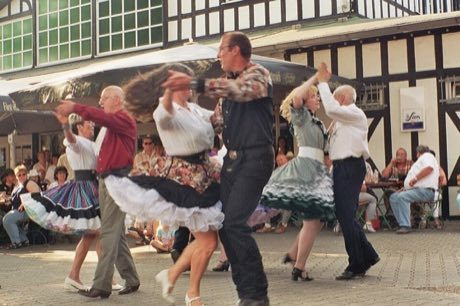

# Square dance caller

*Also known as: Square dance calling*

**Encyclopedia ID 129** (permanent) · https://bpupadhyaya.github.io/world-heritage-games-site/games/129-square-dance-caller/

*Photo: Deirdre 13:59, 24 January 2007 (UTC), [CC BY-SA 3.0](https://creativecommons.org/licenses/by-sa/3.0/), [source on Wikimedia Commons](https://commons.wikimedia.org/wiki/File:Square_Dance_Group.jpg)*

Read the caller's commands (swing, allemande, do-si-do, promenade) and move four couples on the floor so everyone ends where called.

## Heritage note

Part of the living heritage of United States.

## Origins

Usually placed in the era of Modern Heritage (1800 to today), although its exact origins are uncertain, within the cultural world of The Americas: North America.

## Facts

- **Where:** United States
- **Type:** Puzzles and mind games
- **Family:** Puzzle and dexterity toys
- **Era:** [Modern Heritage](../../eras/modern/index.md) (uncertain)
- **Cradle:** [The Americas: North America](../../cradles/north-america/index.md)
- **Region:** Americas

## Play it

[Try a 90-second preview in your browser](https://bpupadhyaya.github.io/games-site/games/square-dance-caller/play/) · [Google Play](https://play.google.com/store/apps/details?id=com.equalinformation.arcforge.shell) · App Store (coming soon)

## Related entries

- [Cornhole](../../games/1194-cornhole/index.md)
- [Table shuffleboard](../../games/1199-table-shuffleboard/index.md)
- [Trick Roping](../../games/1408-trick-roping/index.md)
- [Crokinole](../../games/623-crokinole/index.md)
- [Kingyo-sukui](../../games/3-kingyo-sukui/index.md)
- [Stone Skipping](../../games/5-stone-skipping/index.md)

## Sources

- <https://commons.wikimedia.org/wiki/File:Square_Dance_Group.jpg>
