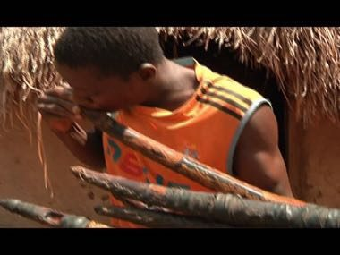

# Gbofe Trumpet Ensemble

*Gbofé d'Afounkaha*

**Encyclopedia ID 1290** (permanent) · https://bpupadhyaya.github.io/world-heritage-games-site/games/1290-gbofe-trumpet-ensemble/

*Photo: asmtci, [CC BY-SA 3.0](https://creativecommons.org/licenses/by-sa/3.0/), [source on Wikimedia Commons](https://commons.wikimedia.org/wiki/File:Joueur_de_trompe.jpg)*

Blow transverse horns on cue, each player holding one note of a hocketing melody, so the ensemble weaves a single tune when everyone enters at the right beat.

## Heritage note

Part of the living heritage of Cote d'Ivoire. Some forms of this practice carry deep meaning for the communities who keep it; here we describe the play and the craft only, with respect for its roots.

## Origins

A living tradition passed from person to person; it is not tied to a single dated origin. It belongs to the cultural world of Africa: Sahel, West and Central.

## Facts

- **Where:** Cote d'Ivoire
- **Type:** Other traditions
- **Era:** [Living Traditions](../../eras/living/index.md) (uncertain)
- **Cradle:** [Africa: Sahel, West and Central](../../cradles/africa-west/index.md)
- **Region:** Sub-Saharan Africa

## Related entries

- [Adinkra Cloth Stamping](../../games/170-adinkra-cloth-stamping/index.md)
- [Korhogo Painted Cloth Studio](../../games/1318-korhogo-painted-cloth-studio/index.md)
- [Kente strip weaving](../../games/22-kente-strip-weaving/index.md)
- [Talking drum](../../games/33-talking-drum/index.md)
- [Bogolan mud cloth](../../games/86-bogolan-mud-cloth/index.md)
- [Adire indigo resist dyeing](../../games/87-adire-indigo-resist-dyeing/index.md)

## Sources

- <https://commons.wikimedia.org/wiki/File:Joueur_de_trompe.jpg>
