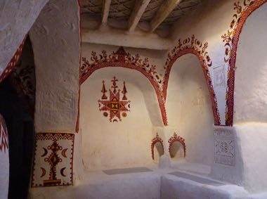

# Ghadames Rooftop Maze

*Ghadames / غدامس*

**Encyclopedia ID 1291** (permanent) · https://equalinformation.com/world-heritage-games-site/games/1291-ghadames-rooftop-maze/

*Photo: Franzfoto, [CC BY-SA 3.0](https://creativecommons.org/licenses/by-sa/3.0/), [source on Wikimedia Commons](https://commons.wikimedia.org/wiki/File:Ghadames_-_Altstadt.jpg)*

Guide a courier across the linked white rooftop terraces and covered alleys of the oasis town to deliver goods before sundown, timing shade, ladders and gates.

## Heritage note

Part of the living heritage of Libya.

## Origins

Usually placed in the era of Modern Heritage (1800 to today), although its exact origins are uncertain, within the cultural world of Mediterranean.

## Facts

- **Where:** Libya
- **Type:** Puzzles and mind games
- **Family:** Puzzle and dexterity toys
- **Era:** [Modern Heritage](../../eras/modern/index.md) (uncertain)
- **Cradle:** [Mediterranean](../../cradles/mediterranean/index.md)
- **Region:** Middle East and North Africa

## Related entries

- [Euclid's Ruler and Compass](../../games/396-euclids-ruler-and-compass/index.md)
- [Antikythera Gear Train](../../games/397-antikythera-gear-train/index.md)
- [Portolan Chart Navigator](../../games/503-portolan-chart-navigator/index.md)
- [Kingyo-sukui](../../games/3-kingyo-sukui/index.md)
- [Stone Skipping](../../games/5-stone-skipping/index.md)
- [Disc-flip](../../games/8-disc-flip/index.md)

## Sources

- <https://commons.wikimedia.org/wiki/File:Ghadames_-_Altstadt.jpg>
