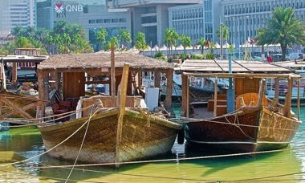

# Gulf Dhow Hull Builder

*بوم / سمبوك*

**Encyclopedia ID 1293** (permanent) · https://equalinformation.com/world-heritage-games-site/games/1293-gulf-dhow-hull-builder/

*Photo: Larry Johnson @ Flickr, [CC BY 2.0](https://creativecommons.org/licenses/by/2.0/), [source on Wikimedia Commons](https://commons.wikimedia.org/wiki/File:Traditional_dhows_on_Doha_Corniche_used_for_pearling.jpg)*

Place hull planks, ribs and a stitched joint in the right order on a shipyard frame, then launch the boat to test it in waves.

## Heritage note

Part of the living heritage of Qatar.

## Origins

A living tradition passed from person to person; it is not tied to a single dated origin. It belongs to the cultural world of Mesopotamia, Levant and Arabia.

## Facts

- **Where:** Qatar
- **Type:** Crafts and making
- **Family:** Textile and weaving crafts
- **Era:** [Living Traditions](../../eras/living/index.md)
- **Cradle:** [Mesopotamia, Levant and Arabia](../../cradles/mesopotamia-levant/index.md)
- **Region:** Middle East and North Africa

## Related entries

- [Tatreez Palestinian Cross-Stitch](../../games/212-tatreez-palestinian-cross-stitch/index.md)
- [Sadu Bedouin ground-loom weaving](../../games/238-sadu-bedouin-ground-loom-weaving/index.md)
- [Al Talli Braid Embroidery](../../games/1273-al-talli-braid-embroidery/index.md)
- [Gargoor Fish-Trap Weaving](../../games/1288-gargoor-fish-trap-weaving/index.md)
- [Kente strip weaving](../../games/22-kente-strip-weaving/index.md)
- [Celtic knot weave](../../games/25-celtic-knot-weave/index.md)

## Sources

- <https://commons.wikimedia.org/wiki/File:Traditional_dhows_on_Doha_Corniche_used_for_pearling.jpg>
