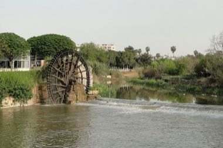

# Hama Noria Waterwheels

*Also known as: Nawaġir Hama · نواعير حماة*

**Encyclopedia ID 1295** (permanent) · https://bpupadhyaya.github.io/world-heritage-games-site/games/1295-hama-noria-waterwheels/

*Photo: Bernard Gagnon, [CC BY-SA 3.0](https://creativecommons.org/licenses/by-sa/3.0/), [source on Wikimedia Commons](https://commons.wikimedia.org/wiki/File:Noria_in_Hama_01.jpg)*

Set the pitch and paddles of giant wooden wheels along a river so each lifts water into an aqueduct channel to irrigate terraces without overflow.

## Heritage note

Part of the living heritage of Syria.

## Origins

Usually placed in the era of Modern Heritage (1800 to today), although its exact origins are uncertain, within the cultural world of Mesopotamia, Levant and Arabia.

## Facts

- **Where:** Syria
- **Type:** Puzzles and mind games
- **Family:** Puzzle and dexterity toys
- **Era:** [Modern Heritage](../../eras/modern/index.md) (uncertain)
- **Cradle:** [Mesopotamia, Levant and Arabia](../../cradles/mesopotamia-levant/index.md)
- **Region:** Middle East and North Africa

## Related entries

- [Al-Jazari water-clock contraptions](../../games/237-al-jazari-water-clock-contraptions/index.md)
- [Phoenician Alphabet Trader](../../games/1359-phoenician-alphabet-trader/index.md)
- [Kingyo-sukui](../../games/3-kingyo-sukui/index.md)
- [Stone Skipping](../../games/5-stone-skipping/index.md)
- [Disc-flip](../../games/8-disc-flip/index.md)
- [Sjoelen](../../games/9-sjoelen/index.md)

## Sources

- <https://commons.wikimedia.org/wiki/File:Noria_in_Hama_01.jpg>
