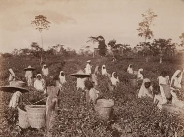

# Hill-country tea plucking

*Also known as: තේ කඩන*

**Encyclopedia ID 1297** (permanent) · https://bpupadhyaya.github.io/world-heritage-games-site/games/1297-hill-country-tea-plucking/

*Photo: Museum of Photographic Arts Collections, No restrictions, [source on Wikimedia Commons](https://commons.wikimedia.org/wiki/File:Plucking_the_Tea,_Ceylon_(7096858619).jpg)*

Walk the terraced slopes and pluck "two leaves and a bud" from the bushes against the clock, sorting quality grades into the basket on your back.

## Heritage note

Part of the living heritage of Sri Lanka.

## Origins

Usually placed in the era of Modern Heritage (1800 to today), although its exact origins are uncertain, within the cultural world of South Asia.

## Facts

- **Where:** Sri Lanka
- **Type:** Puzzles and mind games
- **Family:** Puzzle and dexterity toys
- **Era:** [Modern Heritage](../../eras/modern/index.md) (uncertain)
- **Cradle:** [South Asia](../../cradles/south-asia/index.md)
- **Region:** South and Central Asia

## Related entries

- [Break the pot](../../games/1105-break-the-pot/index.md)
- [Thanjavur dancing doll](../../games/275-thanjavur-dancing-doll/index.md)
- [Chungi](../../games/297-chungi/index.md)
- [Stone put](../../games/589-stone-put/index.md)
- [Dego](../../games/590-dego/index.md)
- [Dandi Biyo](../../games/968-dandi-biyo/index.md)

## Sources

- <https://commons.wikimedia.org/wiki/File:Plucking_the_Tea,_Ceylon_(7096858619).jpg>
