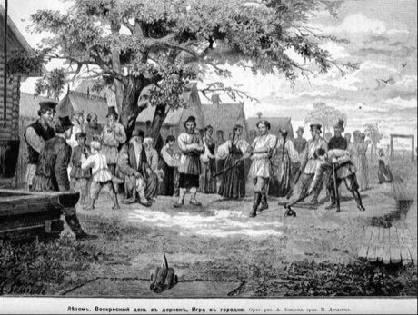

# Gorodki

*Городки · town-skittles*

**Encyclopedia ID 13** (permanent) · https://equalinformation.com/world-heritage-games-site/games/13-gorodki/

*Photo: Unknown authorUnknown author, [Public domain](https://creativecommons.org/publicdomain/mark/1.0/), [source on Wikimedia Commons](https://commons.wikimedia.org/wiki/File:Gorodki.jpg)*

Throw a bat from a distance to knock figures made of wooden pegs out of a square, clearing each shape (cannon, fork, star...) with the fewest throws.

## Heritage note

Part of the living heritage of Russia.

## Origins

Usually placed in the era of Age of Contact and Craft (about 1500 to 1800), although its exact origins are uncertain, within the cultural world of Northern and Eastern Europe.

## Facts

- **Where:** Russia
- **Type:** Dexterity and skill games
- **Family:** Archery and target games
- **Era:** [Age of Contact and Craft](../../eras/contact/index.md) (uncertain)
- **Cradle:** [Northern and Eastern Europe](../../cradles/north-east-europe/index.md)
- **Region:** Europe

## Related entries

- [Kyykka](../../games/715-kyykka/index.md)
- [Skittles](../../games/1179-skittles/index.md)
- [Pub darts](../../games/1182-pub-darts/index.md)
- [Mounted Archery Course](../../games/67-mounted-archery-course/index.md)
- [Kubb](../../games/1120-kubb/index.md)
- [Pitch-pot](../../games/2-pitch-pot/index.md)

## Sources

- <https://commons.wikimedia.org/wiki/File:Gorodki.jpg>
