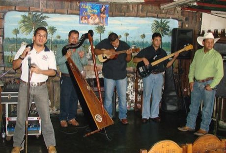

# Joropo llanero band

*Joropo llanero*

**Encyclopedia ID 130** (permanent) · https://bpupadhyaya.github.io/world-heritage-games-site/games/130-joropo-llanero-band/

*Photo: Axoben Bastidas, [CC BY 2.0](https://creativecommons.org/licenses/by/2.0/), [source on Wikimedia Commons](https://commons.wikimedia.org/wiki/File:Arpa,_cuatro,_maracas,_bajo_y_animador..jpg)*

Play the fast triplet strum of the cuatro, shake the maracas and pluck the harp, joining a plains band that builds a lively tune.

## Heritage note

Part of the living heritage of Venezuela, Colombia.

## Origins

Usually placed in the era of Classical Worlds (about 1000 BCE to 500 CE), although its exact origins are uncertain, within the cultural world of The Americas: Andes and South America.

## Facts

- **Where:** Venezuela, Colombia
- **Type:** Musical instruments
- **Family:** String instruments
- **Era:** [Classical Worlds](../../eras/classical/index.md) (uncertain)
- **Cradle:** [The Americas: Andes and South America](../../cradles/andes-south-america/index.md)
- **Region:** Americas

## Related entries

- [Paraguayan Harp](../../games/1425-paraguayan-harp/index.md)
- [Morin khuur](../../games/34-morin-khuur/index.md)
- [Kathputli string puppets](../../games/79-kathputli-string-puppets/index.md)
- [Valiha tube zither](../../games/124-valiha-tube-zither/index.md)
- [Krar lyre](../../games/126-krar-lyre/index.md)
- [Kanklės](../../games/136-kankles/index.md)

## Sources

- <https://commons.wikimedia.org/wiki/File:Arpa,_cuatro,_maracas,_bajo_y_animador..jpg>
