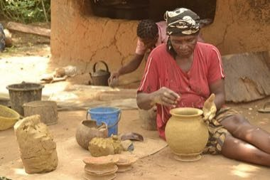

# Ikpu Ite Coil Pot

*Also known as: Ikpu ite (traditional pottery)*

**Encyclopedia ID 1300** (permanent) · https://bpupadhyaya.github.io/world-heritage-games-site/games/1300-ikpu-ite-coil-pot/

*Photo: Chukwukajustice, [CC BY-SA 4.0](https://creativecommons.org/licenses/by-sa/4.0/), [source on Wikimedia Commons](https://commons.wikimedia.org/wiki/File:Traditional_pottery_in_Nigeria_(Ikpu_ite)_16.jpg)*

Build a pot from clay coils, smoothing and decorating it with comb and stamp patterns, then bonfire-fire it without cracking.

## Heritage note

Part of the living heritage of Nigeria.

## Origins

A living tradition passed from person to person; it is not tied to a single dated origin. It belongs to the cultural world of Africa: Sahel, West and Central.

## Facts

- **Where:** Nigeria
- **Type:** Crafts and making
- **Family:** Winter sports
- **Era:** [Living Traditions](../../eras/living/index.md)
- **Cradle:** [Africa: Sahel, West and Central](../../cradles/africa-west/index.md)
- **Region:** Sub-Saharan Africa

## Related entries

- [Freetown Beach Seine Haul](../../games/1282-freetown-beach-seine-haul/index.md)
- [Wire car](../../games/85-wire-car/index.md)
- [Moroccan Mint Tea High Pour](../../games/211-moroccan-mint-tea-high-pour/index.md)
- [Bamboo scaffold builder](../../games/369-bamboo-scaffold-builder/index.md)
- [Neon sign bender](../../games/371-neon-sign-bender/index.md)
- [Maple taffy on snow](../../games/441-maple-taffy-on-snow/index.md)

## Sources

- <https://commons.wikimedia.org/wiki/File:Traditional_pottery_in_Nigeria_(Ikpu_ite)_16.jpg>
