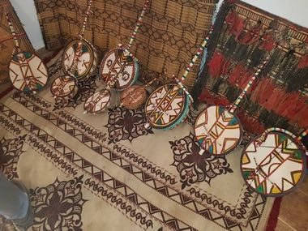

# Imzad Fiddle

*Also known as: Imzad (Tamasheq)*

**Encyclopedia ID 1301** (permanent) · https://bpupadhyaya.github.io/world-heritage-games-site/games/1301-imzad-fiddle/

*Photo: Fayeqalnatour, [CC BY-SA 4.0](https://creativecommons.org/licenses/by-sa/4.0/), [source on Wikimedia Commons](https://commons.wikimedia.org/wiki/File:Amzad_Touareg.jpg)*

Bow a single horsehair string over a gourd resonator while shaping pitch with the left hand to follow glowing melody paths of the Tuareg modal style.

## Heritage note

Part of the living heritage of Niger, Mali, Algeria. Some forms of this practice carry deep meaning for the communities who keep it; here we describe the play and the craft only, with respect for its roots.

## Origins

Usually placed in the era of Classical Worlds (about 1000 BCE to 500 CE), although its exact origins are uncertain, within the cultural world of Africa: Sahel, West and Central.

## Facts

- **Where:** Niger, Mali, Algeria
- **Type:** Musical instruments
- **Family:** String instruments
- **Era:** [Classical Worlds](../../eras/classical/index.md) (uncertain)
- **Cradle:** [Africa: Sahel, West and Central](../../cradles/africa-west/index.md)
- **Region:** Sub-Saharan Africa

## Related entries

- [Kora](../../games/7176-kora/index.md)
- [Fula Riti One-String Fiddle](../../games/1283-fula-riti-one-string-fiddle/index.md)
- [Mvet](../../games/1420-mvet/index.md)
- [Morin khuur](../../games/34-morin-khuur/index.md)
- [Kathputli string puppets](../../games/79-kathputli-string-puppets/index.md)
- [Valiha tube zither](../../games/124-valiha-tube-zither/index.md)

## Sources

- <https://commons.wikimedia.org/wiki/File:Amzad_Touareg.jpg>
