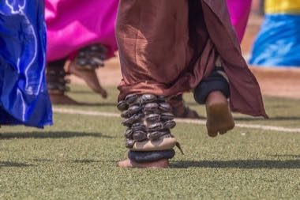

# Intore dance

*Also known as: Intore*

**Encyclopedia ID 1302** (permanent) · https://bpupadhyaya.github.io/world-heritage-games-site/games/1302-intore-dance/

*Photo: Shabanmasengesho, [CC BY-SA 4.0](https://creativecommons.org/licenses/by-sa/4.0/), [source on Wikimedia Commons](https://commons.wikimedia.org/wiki/File:Intore_dancer_during_the_graduation_festivities_at_Kicukiro_stadium_in_Rwanda.jpg)*

Follow leaping steps and ankle-bell rhythm in a group dance.

## Heritage note

Part of the living heritage of Rwanda. It is presented as sport and skill, never as real fighting.

## Origins

A living tradition passed from person to person; it is not tied to a single dated origin. It belongs to the cultural world of Africa: Great Lakes and Indian Ocean.

## Facts

- **Where:** Rwanda
- **Type:** Dances
- **Family:** Folk and line dances
- **Era:** [Living Traditions](../../eras/living/index.md)
- **Cradle:** [Africa: Great Lakes and Indian Ocean](../../cradles/africa-east/index.md)
- **Region:** Sub-Saharan Africa

## Related entries

- [Dabke line dance](../../games/37-dabke-line-dance/index.md)
- [Gumboot dance rhythm](../../games/123-gumboot-dance-rhythm/index.md)
- [Tahtib](../../games/157-tahtib/index.md)
- [Eskista](../../games/188-eskista/index.md)
- [Jebena coffee brewing](../../games/189-jebena-coffee-brewing/index.md)
- [Cueca](../../games/430-cueca/index.md)

## Sources

- <https://commons.wikimedia.org/wiki/File:Intore_dancer_during_the_graduation_festivities_at_Kicukiro_stadium_in_Rwanda.jpg>
- <https://en.wikipedia.org/wiki/Intore>
