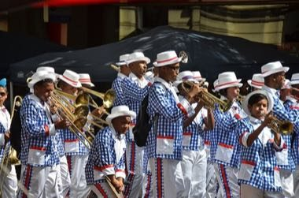

# Kaapse Klopse

*Kaapse Klopse (Cape minstrel parade) · Cape minstrel parade*

**Encyclopedia ID 1307** (permanent) · https://equalinformation.com/world-heritage-games-site/games/1307-kaapse-klopse/

*Photo: Olga Ernst, [CC BY-SA 4.0](https://creativecommons.org/licenses/by-sa/4.0/), [source on Wikimedia Commons](https://commons.wikimedia.org/wiki/File:Kaapse_Klopse_marching_through_Cape_Town_(2017).jpg)*

Lead a marching troupe through Cape Town streets, keeping banjo and brass beats and choreographed formations while earning judging marks.

## Heritage note

Part of the living heritage of Malaysia, South Africa.

## Origins

Usually placed in the era of Modern Heritage (1800 to today), although its exact origins are uncertain, within the cultural world of Southeast Asia and the Islands.

## Facts

- **Where:** Malaysia, South Africa
- **Type:** Street and playground games
- **Era:** [Modern Heritage](../../eras/modern/index.md) (uncertain)
- **Cradle:** [Southeast Asia and the Islands](../../cradles/southeast-asia/index.md)
- **Region:** East and Southeast Asia

## Related entries

- [Lato-lato](../../games/316-lato-lato/index.md)
- [Dikir barat](../../games/1268-dikir-barat/index.md)
- [Gasing uri](../../games/1289-gasing-uri/index.md)
- [Sepak takraw](../../games/802-sepak-takraw/index.md)
- [Gasing](../../games/908-gasing/index.md)
- [Chinlone](../../games/16-chinlone/index.md)

## Sources

- <https://commons.wikimedia.org/wiki/File:Kaapse_Klopse_marching_through_Cape_Town_(2017).jpg>
