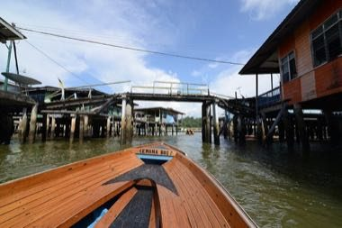

# Kampong Ayer water-taxi dash

**Encyclopedia ID 1308** (permanent) · https://bpupadhyaya.github.io/world-heritage-games-site/games/1308-kampong-ayer-water-taxi-dash/

*Photo: Jorge Láscar from Melbourne, Australia, [CC BY 2.0](https://creativecommons.org/licenses/by/2.0/), [source on Wikimedia Commons](https://commons.wikimedia.org/wiki/File:Kampong_Ayer_(18403648148).jpg)*

Steer a small longboat between stilt-houses and jetties, picking up and dropping neighbours and goods before the tide-and-traffic timer runs out.

## Heritage note

Part of the living heritage of Brunei, Malaysia. Some forms of this practice carry deep meaning for the communities who keep it; here we describe the play and the craft only, with respect for its roots.

## Origins

Usually placed in the era of Classical Worlds (about 1000 BCE to 500 CE), although its exact origins are uncertain, within the cultural world of Southeast Asia and the Islands.

## Facts

- **Where:** Brunei, Malaysia
- **Type:** Water and winter sports
- **Era:** [Classical Worlds](../../eras/classical/index.md) (uncertain)
- **Cradle:** [Southeast Asia and the Islands](../../cradles/southeast-asia/index.md)
- **Region:** East and Southeast Asia

## Related entries

- [Egrang](../../games/17-egrang/index.md)
- [Kulintang](../../games/318-kulintang/index.md)
- [Pencak silat](../../games/329-pencak-silat/index.md)
- [Wau bulan kite](../../games/911-wau-bulan-kite/index.md)
- [Water puppet pond theatre](../../games/303-water-puppet-pond-theatre/index.md)
- [Saung gauk](../../games/306-saung-gauk/index.md)

## Sources

- <https://commons.wikimedia.org/wiki/File:Kampong_Ayer_(18403648148).jpg>
